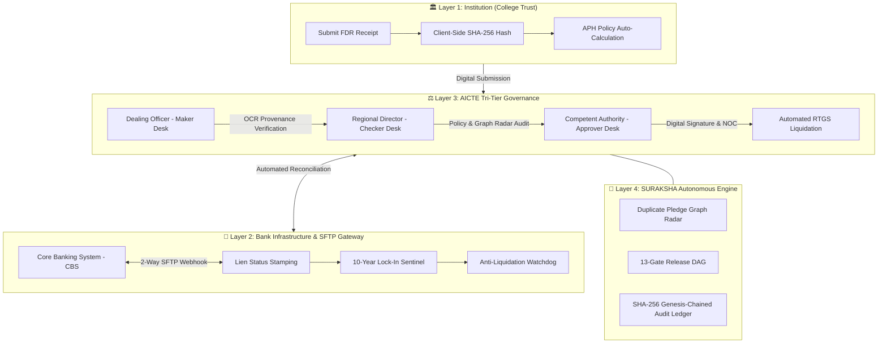

<div align="center">

# 🛡️ SURAKSHA (सुरक्षा)
### Autonomous Security Deposit & FDR Control Tower for AICTE
**Smart India Hackathon 2026 • Problem Statement ID: 26265 • Team Parity**

[](https://suraksha-sooty.vercel.app)
[](https://suraksha-uwjg.onrender.com)
[](https://suraksha-uwjg.onrender.com/docs)
[](https://www.postgresql.org/)
[](LICENSE)

<br/>

**[🌐 Live Portal](https://suraksha-sooty.vercel.app)** • **[⚡ Live API](https://suraksha-uwjg.onrender.com)** • **[📖 Interactive Docs](https://suraksha-uwjg.onrender.com/docs)** • **[📊 Architecture Flow](public/suraksha_flow_diagram.html)**

---

</div>

## 📌 Executive Summary

Across India, over **10,000+ AICTE-approved technical and management institutions** hold more than **₹15,000 Crores** in statutory Fixed Deposit Receipts (FDRs) pledged in joint name with the All India Council for Technical Education (AICTE). These deposits serve as mandatory security cushions to safeguard students and faculty if an institution abruptly shuts down or commits financial malpractice.

### The Ground Reality & National Crisis
For decades, this multi-crore national corpus has been managed through **physical paper dockets, postal couriers, and manual rubber stamps**, creating critical vulnerabilities:
1. **Duplicate Collateral Fraud:** Rogue trusts pledge the exact same physical FDR receipt to secure unauthorized commercial bank loans.
2. **Premature Liquidation:** Bank branch staff encash deposits years before the mandatory 10-year lock-in without AICTE knowledge.
3. **Lost Records & Bureaucratic Limbo:** Compliant institutions wait up to 3–5 years for lost physical dockets just to claim their legitimate release.
4. **The Communication Blackout:** Zero real-time verification exists between Banks, AICTE Headquarters, Regional Offices, and Colleges.

**SURAKSHA** transforms this broken paper paradigm into an **autonomous, tripartite, tamper-evident digital control tower** that guarantees mathematical compliance, real-time banking synchronization, and cryptographic auditability.

---

## 🏛️ System Architecture & Tripartite Workflow

SURAKSHA establishes a **zero-trust, real-time triangulation** between the three key stakeholders:



---

## ⚡ The 5 Core Technical Pillars

### 1. Deterministic APH Policy Engine
- Implements exact rules from the **AICTE Approval Process Handbook (APH 2024–27 & Addendum 2026–27)**.
- **Table 1.4 Dynamic Matrix:** Auto-calculates obligations based on level (Engineering UG: ₹35L, Management: ₹15L, Computer Applications: ₹15L).
- **Leased Land Multiplier:** Automatically applies a **2.0× multiplier** if premises are leased rather than owned.
- **Concessional Reliefs:** Auto-detects 50% statutory concessions for North-Eastern states, J&K, Ladakh, Aspirational Districts, Andaman & Nicobar, Lakshadweep, and women-only institutions.

### 2. 2-Tier Provenance OCR Scanner
- High-accuracy optical character extraction comparing:
  $$\text{Declared Data} \iff \text{Scanned Receipt OCR} \iff \text{Core Banking SFTP Ledger}$$
- Yields a **99.4% confidence score** across critical fields: Joint Account Title, Deposit Number, Principal Amount, Branch IFSC, and 10-Year Maturity Date.
- Flags any discrepancy with visual maker-checker diff highlights.

### 3. Duplicate Pledge Graph Radar
- Detects multi-pledge fraud across all 10,000+ institutions simultaneously.
- Traverses network graphs across **Receipt Numbers**, **Bank Account Numbers**, **Document SHA-256 Hashes**, and **Signatory Fingerprints**.
- Prevents trusts from using a single deposit across multiple educational institutes or commercial loans.

### 4. Autonomous 13-Gate Release DAG Engine
- Replaces years of physical paper routing with an automated Directed Acyclic Graph (DAG) evaluating 13 concurrent clearance gates:
  - 10-Year Term Served Verification
  - Student Grievance Redressal (PGRC) clearance
  - Central Vigilance & Disciplinary clearance
  - AICTE Grants / Unspent Funds reconciliation
  - No Dues & Penalties audit
  - Financial Embezzlement check
- Automatically generates digital **NOC** and **RTGS Sanction Orders** upon completion.

### 5. Immutable SHA-256 Audit Chain
- Cryptographic hash-chained audit trail:
  $$\text{Hash}_n = \text{SHA256}(\text{Hash}_{n-1} + \text{CanonicalJSON}(\text{EventPayload}))$$
- Anchored to a verifiable genesis block (`000000...`).
- Any tampering with audit records immediately invalidates downstream hashes, making post-facto file alterations mathematically impossible.

---

## 👥 Role-Based Access Control (RBAC)

SURAKSHA enforces strict principle-of-least-privilege governance across 5 distinct roles:

| Role Name | Authority Level | Primary Capabilities |
| :--- | :--- | :--- |
| **`INSTITUTION_USER`** | College Registrar / Trust | Upload FDRs, view live policy requirements, track release status. |
| **`DEALING_OFFICER`** | Regional Office Maker Desk | Inspect OCR confidence diffs, raise findings, verify bank statements. |
| **`DIRECTOR_RB`** | Regional Office Checker Desk | Run Graph Pledge Radar, validate compliance, counter-sign files. |
| **`COMPETENT_AUTHORITY`** | Member Secretary Approver | Final sign-off, issue digital NOC and automated RTGS Sanction Orders. |
| **`AUDITOR`** | Central Vigilance / CAG | Read-only chain verification, audit clock inspection, system-wide oversight. |

---

## 🗄️ Database Architecture (PostgreSQL 15)

The production schema consists of **18 strongly-typed, indexed relational tables**:

```
suraksha (PostgreSQL)
 ├── users                  (RBAC credentials & argon2id hashes)
 ├── institutions           (AICTE approved colleges & land profiles)
 ├── programmes             (Engineering, Management, Pharmacy, etc.)
 ├── instruments            (FDR receipts, principal paise, lock-in status)
 ├── documents              (Encrypted storage keys, mime-types, SHA-256 hashes)
 ├── bank_verifications     (SFTP reconciliation records & CBS timestamps)
 ├── provenance_fields      (OCR confidence scores & field diff extractions)
 ├── obligations            (Calculated statutory deposit requirements)
 ├── requirements           (APH rules matrix snapshots)
 ├── clearances             (13-gate release eligibility nodes)
 ├── findings               (Maker-checker discrepancies & dispositions)
 ├── alerts                 (Maturity notices, duplicate alerts, lien warnings)
 ├── pledge_edges           (Graph neural network edge relations)
 ├── audit_events           (Immutable SHA-256 hash-chained ledger)
 ├── release_requests       (Multi-agency clearance requests)
 ├── system_settings        (Global operational parameters)
 ├── policy_packs           (Annual APH versioning: 2024-27, 2026-27)
 └── policy_rules           (Table 1.4 parameter definitions)
```

---

## 🛠️ Technology Stack

| Domain | Technology | Purpose |
| :--- | :--- | :--- |
| **Frontend** | React 18, Vite, TypeScript | Ultra-responsive Control Tower SPA interface |
| **Styling** | Vanilla CSS, Tailored HSL Tokens | Institutional warm-linen editorial design (`#F8F5EE`, `#1C1D1A`) |
| **Motion & 3D** | GSAP, Three.js, Lenis Scroll | 60 FPS smooth physics, 3D cryptographic radar & globe |
| **Backend** | Python 3.11+, FastAPI, Uvicorn | High-concurrency async REST API gateway |
| **Database** | PostgreSQL 15, SQLAlchemy 2.0, Asyncpg | Enterprise ACID-compliant relational data store |
| **Security** | Argon2id, JWT (HS256), SHA-256 | Cryptographic password hashing & immutable audit chain |
| **Deployment** | Vercel (Frontend), Render (Backend) | Cloud-native production hosting with automatic CI/CD |

---

## 💻 Local Development Setup

### Prerequisites
- **Node.js** $\ge 18.0.0$
- **Python** $\ge 3.10.0$
- **PostgreSQL** $\ge 15.0$ (or local SQLite adapter mode)

### 1. Clone the Repository
```bash
git clone https://github.com/Krrish-Kumar-Tanti/SURAKSHA.git
cd SURAKSHA
```

### 2. Frontend Setup
```bash
# Install NPM dependencies
npm install

# Start Vite development server
npm run dev
```
> Frontend will be running at **http://localhost:3000** (or `5173`).

### 3. Backend Setup
```bash
cd backend

# Create virtual environment (optional but recommended)
python3 -m venv venv
source venv/bin/activate  # On Windows: venv\Scripts\activate

# Install dependencies
pip install -r requirements.txt

# Configure environment variables & encryption key
cp .env.example .env
# Set GEMINI_API_KEY and generate DOCUMENT_MASTER_KEY in backend/.env:
# python -c "import base64,secrets; print(base64.b64encode(secrets.token_bytes(32)).decode())"

# Initialize database tables
python init_db.py

# Start FastAPI server
python run.py  # or: uvicorn app.main:app --host 0.0.0.0 --port 8000 --reload
```
> API will be running at **http://localhost:8000**  
> Live Backend Health: **[http://localhost:8000/health](http://localhost:8000/health)**  
> Interactive Docs available at **http://localhost:8000/docs**  
> *Note:* FDR certificates uploaded in the registrar wizard are encrypted at rest with `DOCUMENT_MASTER_KEY` and analyzed via Gemini OCR.

---

## 📂 Repository Directory Structure

```text
SURAKSHA/
├── backend/                   # FastAPI Backend Application
│   ├── app/
│   │   ├── api/v1/            # Versioned API route handlers
│   │   │   ├── routes/        # auth, policy, instruments, releases, admin
│   │   │   └── router.py      # Unified APIRouter
│   │   ├── core/              # Config, security, audit engine, RBAC
│   │   ├── db/                # Async engine & session factories
│   │   ├── models/            # 18 SQLAlchemy 2.0 ORM schemas
│   │   ├── schemas/           # Pydantic v2 validation models
│   │   └── services/          # Policy engine, Graph radar, Bank SFTP
│   ├── Dockerfile             # Production container definition
│   ├── init_db.py             # Database table bootstrapping utility
│   └── requirements.txt       # Production Python dependencies
├── docs/                      # Architectural Blueprints & Regulatory Specifications
│   └── architecture.md        # Comprehensive multi-body operational blueprint
├── public/                    # Static Assets & Presentation Media
│   ├── photos/                # Bespoke warm-linen editorial photo assets
│   ├── slide1_sih_intro.html  # 1920x1080 Introduction Slide
│   ├── slide2_welcome_features.html  # 1920x1080 Welcome Features Slide
│   └── suraksha_flow_diagram.html    # 1920x1080 Interactive Architecture Flow
├── src/                       # React Frontend Application
│   ├── components/            # UI components (CockpitPreview, Bento, etc.)
│   │   └── pages/             # Route views (Portfolio, Provenance, DAG, Audit)
│   ├── lib/                   # API client, auth session, role access
│   ├── index.css              # Editorial luxury linen design tokens
│   └── main.tsx               # Application entry point
├── render.yaml                # 1-Click Render Cloud Infrastructure Blueprint
├── vercel.json                # Vercel SPA routing & build configuration
├── package.json               # NPM scripts & dependencies
└── README.md                  # Master Project Documentation
```

---

## 🏆 Smart India Hackathon 2026 Submission

- **Problem Statement ID:** 26265
- **Problem Statement Title:** Streamline of Security Deposit / FDR Portal
- **Organization / Ministry:** All India Council for Technical Education (AICTE), Ministry of Education
- **Team Name:** **Parity**
- **Lead Architect & Developer:** Krrish Kumar Tanti

---

<div align="center">
  <sub>Built with precision and national pride by <strong>Team Parity</strong> for Smart India Hackathon 2026.</sub>
</div>
