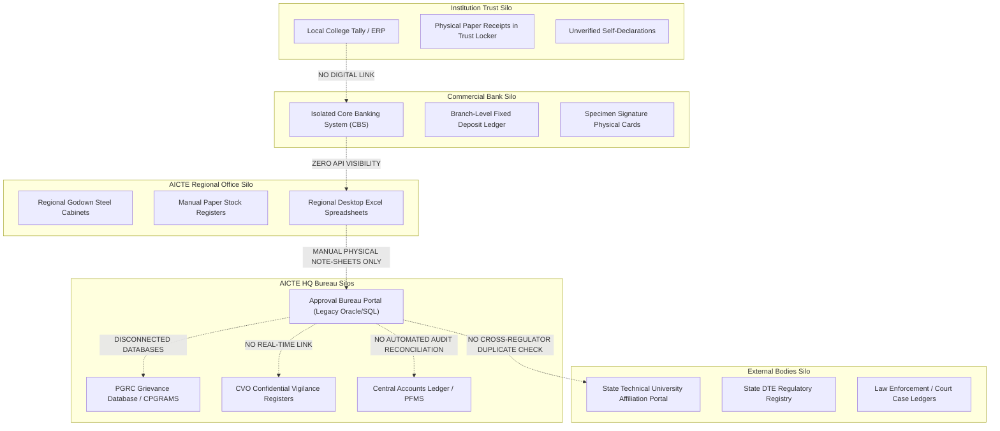
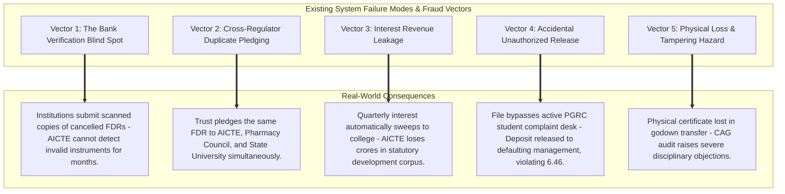

# Official Architectural Flow of Existing Bodies: AICTE Security Deposit / FDR Lifecycle (SIH26265)

> **Document Status:** Official As-Is Architectural Flow & Multi-Body Operational Blueprint  
> **Problem Statement ID:** SIH26265 — Streamlining of Security Deposit / Fixed Deposit Receipt (FDR) Portal for AICTE Approved Institutions  
> **Governing Regulatory Framework:** AICTE Act 1987 (Act 52 of 1987) | Approval Process Handbook (APH 2024–25 to 2026–27) | Addendum & Corrigendum 2026–27  
> **Target Audience:** System Architects, AICTE Regulation & Approval Bureaus, Regional Officers, Evaluation Jury

---

## 1. Executive Summary & Regulatory Context

Technical education institutions seeking approval under the **All India Council for Technical Education (AICTE)** must establish and maintain a mandatory Security Deposit (traditionally held as a **Fixed Deposit Receipt - FDR**, or **Refundable Performance Guaranty Fund - RPGF / RTGS**). 

The security deposit is a statutory financial instrument designed to guarantee institutional financial stability, safeguard student and faculty welfare, ensure compliance with infrastructure norms, and serve as collateral against regulatory violations.

```
                      STATUTORY FINANCIAL COMMITMENT
  ┌────────────────────────────────────────────────────────────────────────┐
  │  Base Deposit Amount (Table 1.4):  ₹15 Lakh to ₹35 Lakh (per programme)│
  │  Leased Land / Building Multiplier:  2.0× (up to ₹70 Lakh per college) │
  │  Mandatory Custody Tenure:          10 Years Continuously Pledged      │
  │  Interest Treatment:                100% Retained & Utilized by AICTE  │
  │  National Corpus at Stake:          ₹2,500+ Crore across 10,000+ Inst. │
  │  Constitutional Audit Liability:    CAG & Central Vigilance Commission │
  └────────────────────────────────────────────────────────────────────────┘
```

### The Core Problem Today
In the current manual, paper-intensive setup, **no centralized digital control tower exists**. Operations are fragmented across physical post offices, regional steel godowns, disconnected bank branches, manual physical registers, and disparate internal bureaus. This causes:
1. **The Bank Verification Blind Spot:** AICTE has no direct API or automated verification with commercial banks. Officers cannot tell whether an uploaded paper scan corresponds to an active, lien-locked deposit in the bank's Core Banking System (CBS) or a forged/encashed receipt.
2. **The Multi-Bureau Paper Chase:** Releasing a deposit after 10 years requires physical clearances from student complaint cells, anti-corruption vigilance, and grant recovery desks. Files crawl through physical note-sheets for 6 to 24 months.
3. **Cross-Institution Duplicate Pledges:** Sponsoring trusts can take a single physical FDR and pledge it to multiple regulators (e.g., AICTE, State University, Pharmacy Council of India) without detection.
4. **Interest Corpus Leakage:** Banks frequently auto-credit compounding interest back to college trust savings accounts instead of retaining and remitting it to AICTE's central development fund.

---

## 2. Institutional Directory of Existing Official Bodies

To understand the architectural flow, we must first map the seven distinct institutional bodies participating in the official security deposit lifecycle, their jurisdictions, and their administrative touchpoints.

| # | Official Body | Key Role & Administrative Touchpoints | Governing Mandates / Clauses |
|---|---|---|---|
| **1** | **Applicant / Technical Institution** (Trust / Society / Section 8 Company) | Sponsoring management that establishes the institute. Opens joint bank accounts, purchases physical FDRs, submits stamped affidavits, and applies for 10-year maturity refund or closure release. | APH Clause 1.12, Clause 1.5.2, Affidavit 3, Affidavit 6 |
| **2** | **Commercial / Nationalized Banks** (SBI, PNB, Canara, HDFC, ICICI, etc.) | Issuing branch manager and deposit desk. Generates physical paper FDRs, accepts joint mandate ("Trust Chairman AND Regional Officer, AICTE"), marks regulatory lien, and disburses maturity proceeds upon receipt of official release letters. | RBI Master Circular on Term Deposits, Banking Regulation Act |
| **3** | **AICTE Regional Offices (ROs)** (14 Regional Zones across India) | Custody gatekeepers headed by the **Regional Officer (RO)** and **Assistant Director / Custody Officer**. Manages physical custody of paper certificates in regional godowns, maintains physical stock registers, issues manual bank postal inquiries, and countersigns joint mandates. | APH Clause 1.12(iv), Clause 2.20(d), RO Jurisdiction Manual |
| **4** | **AICTE Headquarters: Approval Bureau & Regulation Bureau (New Delhi)** | **Regulation Bureau (RB):** Sets deposit policy, handles regulatory scrutiny, calculates penalties (Clause 2.25, Clause 7.7), and monitors compliance.<br>**Approval Bureau (AB):** Issues Letters of Approval (LoA), Extensions of Approval (EoA), and issues formal **Release No Objection Certificates (NOC)** under Clause 6.46(c). | AICTE Act 1987 Section 10, APH Table 1.4, Clause 6.46(c) |
| **5** | **AICTE Statutory Clearances Desks (Internal Cells)** | **PGRC (Public Grievance Redressal Cell):** Investigates student/faculty complaints (capitation fee, withheld certificates, ragging).<br>**CVO / Vigilance Cell:** Investigates document forgery, ghost faculty, and corrupt practices under CVC oversight.<br>**Finance & Grants Bureau:** Audits research and institutional development grants (MODROBS, RPS, PMKVY) to recover unspent balances. | APH Clause 6.46(b), Central Vigilance Commission Act 2003 |
| **6** | **External Regulators & Law Enforcement Agencies** | **Affiliating State University / Board (SBTE):** Issues affiliation and progressive closure / merger "No Students Studying" certificates.<br>**State Directorate of Technical Education (DTE):** State-level NOC and fee monitoring.<br>**Investigating Agencies (CBI, ED, Police):** Special clearance under Clause 6.46(e) for financial embezzlement inquiries. | APH Clause 6.46(e), 6.46(h), 6.46(i), State Technical Education Acts |
| **7** | **AICTE Central Finance & Accounts Division / CAG** | Manages central treasury fund, reconciles RTGS deposits, issues financial **Sanction Orders** under Clause 6.46(d), remits refunds via PFMS, and faces statutory audit liability from the **Comptroller & Auditor General of India (CAG)**. | APH Clause 6.46(d), General Financial Rules (GFR), CAG Auditing Standards |

---

## 3. High-Level Multi-Entity Operational Flowchart

The following diagram maps the entire official ecosystem, showing how records, paper instruments, postal mail, and physical note-sheets move across all official bodies from initial deposit creation to 10-year maturity refund or forfeiture.

```mermaid
flowchart TD
    %% Styling Configuration
    classDef college fill:#e0f2fe,stroke:#0284c7,stroke-width:2px,color:#0f172a;
    classDef bank fill:#fef3c7,stroke:#d97706,stroke-width:2px,color:#0f172a;
    classDef regional fill:#f1f5f9,stroke:#475569,stroke-width:2px,color:#0f172a;
    classDef aicteHQ fill:#fee2e2,stroke:#dc2626,stroke-width:2px,color:#0f172a;
    classDef clearance fill:#f3e8ff,stroke:#9333ea,stroke-width:2px,color:#0f172a;
    classDef external fill:#ecfdf5,stroke:#059669,stroke-width:2px,color:#0f172a;

    subgraph CollegeBody ["1. Technical Institution / Sponsoring Trust"]
        C1["Trust / College Management"]:::college
        C2["Deposit Intimation Receipt<br>(LoA Stage)"]:::college
        C3["Affidavit 3 / 6 on Non-Judicial<br>Stamp Paper"]:::college
        C4["Release Application Dossier<br>(After 10 Years)"]:::college
    end

    subgraph BankBody ["2. Commercial / Scheduled Bank Branch"]
        B1["Bank Branch Manager / Cashier"]:::bank
        B2["Term Deposit Ledger / Core Banking (CBS)"]:::bank
        B3["Physical Paper FDR Certificate<br>(Watermark Stationery)"]:::bank
        B4["Manual Postal Reply Letter<br>(Verification Confirmation)"]:::bank
        B5["Final Encashment / Settlement"]:::bank
    end

    subgraph RegionalBody ["3. AICTE Regional Office (RO)"]
        RO1["Assistant Director / Custody Officer"]:::regional
        RO2["Physical Steel Safe / Godown Custody"]:::regional
        RO3["Manual Stock Register / Local Excel Tracker"]:::regional
        RO4["Postal Verification Dispatch Desk"]:::regional
        RO5["Regional Officer (RO) Co-Signatory"]:::regional
    end

    subgraph HQBureau ["4. AICTE HQ (Approval & Regulation Bureaus)"]
        HQ1["Regulation Bureau (Policy & Scrutiny)"]:::aicteHQ
        HQ2["Approval Bureau (LoA / EoA Desk)"]:::aicteHQ
        HQ3["Competent Authority (Member Secretary / EC)"]:::aicteHQ
        HQ4["Central Accounts Division (PFMS / RTGS)"]:::aicteHQ
    end

    subgraph StatutoryClearance ["5. Internal Statutory Clearance Desks (APH 6.46b)"]
        PGRC["PGRC Desk<br>(Student / Faculty Grievances)"]:::clearance
        VIG["CVO / Vigilance Desk<br>(Disciplinary / Forgery Probes)"]:::clearance
        GRANTS["Finance & Grants Desk<br>(MODROBS / RPS Recovery)"]:::clearance
    end

    subgraph ExternalBodies ["6. External Oversight Bodies"]
        UNIV["Affiliating University / SBTE<br>(No-Students Certificate)"]:::external
        EMBEZ["Investigating Agencies (CBI / ED / Police)<br>(Clause 6.46e Embezzlement NOC)"]:::external
        CAG["CAG External Audit Inspection"]:::external
    end

    %% Flow Connections - Phase 1: Creation & Intake
    HQ2 -- "1. Issues LoA Intimation with Deposit Requirement" --> C2
    C2 --> C1
    C1 -- "2. Submits Funds & Mandate Request" --> B1
    B1 -- "3. Issues Joint Account FDR Certificate" --> B3
    B1 -. "Marks Lien in CBS (Often missed/unverified)" .-> B2
    C1 -- "4. Prepares Physical Sworn Affidavits" --> C3
    B3 -- "5. Physical Submission via Speed Post / Hand Courier" --> RO1
    C3 -- "5. Physical Submission via Speed Post / Hand Courier" --> RO1

    %% Flow Connections - Phase 2: Regional Custody & Verification
    RO1 -- "6. Records Entry in Physical Ledger" --> RO3
    RO1 -- "7. Locks Physical Paper Certificate in Godown" --> RO2
    RO1 -- "8. Mails Physical Verification Letter via Speed Post" --> RO4
    RO4 -- "9. Postal In Transit (Weeks delay)" --> B1
    B1 -- "10. Types Bank Confirmation Letter" --> B4
    B4 -- "11. Returned via Post to Regional Office" --> RO1

    %% Flow Connections - Phase 3: 10-Year Holding & Maturity Monitoring
    RO3 -. "12. 10 Years Inactive Custody (Interest leakage risk)" .-> RO2
    CAG -- "Audit Inspection of Missing / Lapsed FDRs" --> RO2

    %% Flow Connections - Phase 4: Release Workflow (Clause 6.46)
    C1 -- "13. Submits 10-Yr Release Application Dossier" --> C4
    C4 --> RO1
    RO1 -- "14. Retrieves Paper FDR & Prepares Physical File" --> RO2
    RO1 -- "15. Transmits Physical Note-Sheet File to HQ" --> HQ1
    
    %% Multi-Bureau Routing
    HQ1 -- "16a. Physical File Routed" --> PGRC
    HQ1 -- "16b. Physical File Routed" --> VIG
    HQ1 -- "16c. Physical File Routed" --> GRANTS
    HQ1 -- "16d. Closure Verification" --> UNIV
    HQ1 -. "16e. If Fraud Inquiry Exists" .-> EMBEZ

    PGRC -- "17. Manual Clearance Endorsements" --> HQ1
    VIG -- "17. Manual Clearance Endorsements" --> HQ1
    GRANTS -- "17. Manual Clearance Endorsements" --> HQ1
    UNIV -- "17. Manual Clearance Endorsements" --> HQ1
    EMBEZ -. "Clause 6.46e External NOC" .-> HQ1

    %% Phase 5: Approval & Disbursement
    HQ1 -- "18. Recommends Release Dossier" --> HQ3
    HQ3 -- "19. Formal Approval Sanctioned" --> HQ2
    
    HQ2 -- "20a. Issues Physical FDR Release NOC" --> C1
    HQ2 -- "20b. Sends Release Order" --> B1
    HQ3 -. "20c. If RTGS Deposit: Sanction Order" .-> HQ4
    HQ4 -. "20d. Disburses Principal via PFMS" .-> C1

    C1 -- "21. Presents Physical NOC & FDR Certificate" --> B5
    B1 --> B5
    B5 -- "22. Principal Refund Credited to Trust Account" --> C1
```



---

## 4. Phase-by-Phase Detailed Architectural Breakdown

Let us examine the exact procedural, document, and data movements that occur during each phase of the existing lifecycle.

```
┌─────────────────────────────────────────────────────────────────────────────┐
│                       5-STAGE OPERATIONAL LIFECYCLE                         │
├──────────────┬──────────────┬──────────────┬──────────────┬─────────────────┤
│   STAGE 1    │   STAGE 2    │   STAGE 3    │   STAGE 4    │     STAGE 5     │
│   Deposit    │  Lien Lock   │ 10-Year Hold │ Clause 6.46  │  Disbursement   │
│ Creation and │  and Godown  │ and Interest │ Multi-Bureau │   and Release   │
│ Intake Flow  │ Custodial OK │  Monitoring  │ Paper Chase  │    Settlement   │
└──────────────┴──────────────┴──────────────┴──────────────┴─────────────────┘
```

---

### Stage 1: Deposit Calculation, Joint Account Creation & Intake Flow

When a new technical institution is recommended for approval by the AICTE Executive Committee, or an existing institution expands into a new program/level, it enters the mandatory deposit workflow.

```mermaid
sequenceDiagram
    autonumber
    actor College as Sponsoring Trust / College
    participant Bank as Commercial Bank Branch
    participant Portal as AICTE Legacy Portal
    actor RO as Regional Office Dealing Officer
    participant Vault as Physical Steel Cabinet (Godown)

    Note over College,Portal: Approval Process Handbook (APH) Calculation
    College->>College: Manually looks up Table 1.4 norms (e.g. ₹35L for Engg UG)
    Note over College: High risk of missing 2026-27 Addendum 50% concession or 2.0x lease multiplier
    College->>Bank: Approaches Branch with Trust resolution & AICTE intimation letter
    Bank->>Bank: Opens Joint Term Deposit Account<br>"Trust Chairman AND Regional Officer, AICTE"
    Bank->>Bank: Enters deposit into CBS; writes lien note in branch internal register
    Bank-->>College: Issues physical paper FDR on high-security watermark stationery
    College->>College: Drafts Affidavit 3 / Affidavit 6 on ₹100 non-judicial stamp paper
    College->>College: Notarizes affidavit with public notary
    College->>Portal: Uploads low-resolution scanned PDF of FDR & affidavit
    Note over Portal: Legacy portal acts as passive document locker (No OCR, No CBS check)
    College->>RO: Dispatches original physical paper FDR & original stamp affidavit via Registered Speed Post
    RO->>RO: Receives mail envelope; unseals physical paper documents
    RO->>RO: Manually writes accession number in paper Stock Ledger / Excel file
    RO->>Vault: Physically files paper certificate into steel shelf/folder
    Note over RO,Vault: Single point of failure: Lost paper = CAG audit liability
```

#### Ground Realities & Vulnerabilities in Stage 1:
1. **Miscalculation of Statutory Deposit Amount:** Under the **APH 2026–27 Corrigendum (Items 10 & 11)**, an Engineering UG college requires ₹35 Lakh base deposit. However:
   - If located in North Eastern States, J&K, Ladakh, Aspirational Districts, A&N, Lakshadweep, or if it is a Women-only or PwD-only institute, the rate is **50% (₹17.5 Lakh)**.
   - If operating on leased land/building, the rate is **DOUBLED (2.0×)**.
   - College trusts frequently submit incorrect amounts due to manual calculations, leading to under-pledged deposits or prolonged legal disputes.
2. **Joint Mandate Flaws:** Banks routinely misprint the joint mandate wording. Common errors include omitting the Regional Officer's official designation or listing "AICTE" as a secondary party with single-signatory rights for the college chairman.

---

### Stage 2: Custodial Verification & The "Bank Verification Blind Spot"

Once the physical paper FDR arrives at the Regional Office, regulatory guidelines require the AICTE Regional Officer to verify that the instrument is genuine and that an unalterable lien in favour of AICTE is marked in the bank's books.

```mermaid
sequenceDiagram
    autonumber
    actor RO as AICTE Regional Dealing Officer
    participant Post as Indian Postal Service (Speed Post)
    actor BM as Bank Branch Manager
    participant CBS as Bank Core Banking System (Finacle / BaNCS)
    participant Fraud as Malicious / Defaulter Institution

    RO->>RO: Drafts physical inquiry letter: "Verification of Lien marking on FDR No. XYZ"
    RO->>Post: Dispatches paper inquiry letter with stamp
    Note over Post: Delivery transit takes 1 to 4 weeks depending on rural branch location
    Post->>BM: Delivers physical paper letter to branch inward desk
    BM->>CBS: Searches branch term deposit ledger for FDR account
    alt Case A: Genuine Compliant Bank
        BM->>CBS: Checks if lien code "REGULATORY_AICTE" is active
        BM->>BM: Types confirmation letter on official bank letterhead
        BM->>Post: Posts confirmation letter back to AICTE Regional Office
        Post->>RO: Delivers confirmation letter
        RO->>RO: Marks "Verified" in local spreadsheet; files paper reply
    else Case B: Unresponsive Rural Branch (Very Common)
        Note over BM: Branch manager transfers out or ignores inquiry; letter sits in pile
        Note over RO: RO dealing officer has no automated reminders; inquiry forgotten
        RO->>RO: FDR remains "Pending Verification" indefinitely
    else Case C: Fraudulent Collusion or Premature Encashment
        Fraud->>BM: Convinces branch to release funds or issue loan against deposit
        BM->>Fraud: Disburses funds without AICTE knowledge
        Note over RO,Fraud: AICTE still holds paper certificate in godown believing deposit is secure!
    end
```

#### Architectural Failure Modes in Stage 2:
- **Zero API Handshake:** AICTE operates completely isolated from banking channels (SFMS, NEFT/RTGS, NeSL e-BG, RBI Account Aggregator).
- **Static Paper Illusion:** Holding the physical paper receipt provides zero cryptographic or financial guarantee that the balance remains intact in the bank branch.

---

### Stage 3: The 10-Year Holding Period & Interest Corpus Leakage

Under **APH Clause 1.12(iv)**, the security deposit must remain with AICTE for **10 years**. The interest accumulated on the deposit is **statutorily retained and utilized by the Council** for institutional development, quality improvement, and student scholarships.

```mermaid
flowchart LR
    subgraph RegulatoryMandate ["APH Statutory Law - Clause 1.12"]
        M1["10-Year Mandatory Custody"]
        M2["Principal Amount Returned to Trust at Maturity"]
        M3["100% Accumulated Interest RETAINED by AICTE Council"]
    end

    subgraph ActualAsIsPractice ["Current Operational Reality - High Leakage"]
        A1["FDR locked in steel cupboard for 10 years"]
        A2["No automated maturity alerts - T-90, T-60, T-30"]
        A3["Bank branch sets FDR to 'Auto-Credit Interest' to Trust Savings A/C"]
        A4["Or Bank auto-renews at lower interest without AICTE knowledge"]
    end

    subgraph CAGAuditConsequences ["Audit and Legal Liability"]
        C1["CAG issues strict audit queries on lost interest revenue"]
        C2["AICTE Regional Officers held personally accountable"]
        C3["College trusts claim interest at maturity, causing litigation"]
    end

    RegulatoryMandate -.->|"Broken by manual disconnect"| ActualAsIsPractice
    ActualAsIsPractice ==>|"Triggers"| CAGAuditConsequences
```



#### Why Interest Leakage Occurs:
1. When opening fixed deposits, branch clerks often select default software templates in Core Banking Systems (such as Infosys Finacle or TCS BaNCS) that automatically sweep quarterly interest payouts into the sponsoring trust's operational savings account.
2. Because AICTE does not receive periodic electronic statements from banks, tens of crores of rupees in statutory interest revenue are lost every year across thousands of approved technical colleges.

---

### Stage 4: Release / Refund Workflow & The Multi-Bureau Paper Chase

When an institution completes its 10-year term, or applies for progressive closure / merger, it applies for deposit release under **APH Clause 6.46**. This triggers one of the most complex, delay-ridden paper chases in the Indian higher education administration.

```mermaid
sequenceDiagram
    autonumber
    actor College as Sponsoring Trust Chairman
    actor RO as AICTE Regional Office (Dealing Officer)
    actor AB as AICTE HQ Approval Bureau (New Delhi)
    participant PGRC as Public Grievance Redressal Cell
    participant VIG as Chief Vigilance Officer
    participant GRANTS as Finance and Grants Bureau
    actor CA as Competent Authority
    participant Bank as Issuing Bank Branch

    College->>RO: Submits Release Dossier (Request Letter + Affidavit 6 + FDR Copies + LoA/EoA)
    RO->>RO: Searches physical steel godown to locate original 10-year-old paper FDR
    Note over RO: If paper file is misplaced ("File Not Traceable"), delay exceeds 6 months!
    RO->>AB: Prepares physical note-sheet and dispatches file to AICTE Headquarters (New Delhi)
    
    Note over AB,GRANTS: Clause 6.46(b) Mandatory Statutory Clearance Routing
    AB->>PGRC: Sends physical note-sheet: "Any student/faculty ragging/fee complaints pending?"
    PGRC->>PGRC: Manually queries regional complaint registers and CPGRAMS
    PGRC-->>AB: Manual written endorsement: "No pending complaint" (or "Complaint #402 Pending!")
    
    AB->>VIG: Sends physical note-sheet: "Any CVO / CVC disciplinary inquiry active?"
    VIG->>VIG: Manually checks vigilance ledger for fake documents or ghost faculty probes
    VIG-->>AB: Manual written endorsement: "Vigilance Cleared"
    
    AB->>GRANTS: Sends physical note-sheet: "Any unspent MODROBS / RPS research grants?"
    GRANTS->>GRANTS: Manually audits institutional grant ledgers
    GRANTS-->>AB: Manual written endorsement: "No dues pending"
    
    Note over AB: If Progressive Closure / Merger (Clause 6.46 h, i):
    AB->>College: Demands physical "No Students Studying" certificate from Affiliating University
    College-->>AB: Courier certificate from State University Registrar
    
    Note over AB: If Financial Embezzlement Alleged (Clause 6.46 e):
    AB->>College: Demands formal NOC from Police / CBI / ED investigating agency
    
    AB->>CA: Consolidates all paper endorsements and presents note-sheet for approval
    CA->>CA: Scrutinizes file; signs physical approval order
    CA-->>AB: Transmits signed file
    AB->>College: Issues physical No Objection Certificate (NOC) addressed to Bank Branch Manager
    College->>Bank: Submits original FDR + AICTE Physical NOC letter
    Bank->>Bank: Verifies signatures of AICTE officers against specimen records
    Bank-->>College: Encashment complete: Credits principal amount to Trust Account
```

#### Detailed Breakdown of Statutory Clearances Required Under Clause 6.46:

```
┌─────────────────────────────────────────────────────────────────────────────┐
│                    CLAUSE 6.46 STATUTORY CLEARANCE GATES                    │
├────────────────────┬────────────────────────────────────────────────────────┤
│ Clearance Desk     │ Specific Mandatory Check & Legal Authority             │
├────────────────────┼────────────────────────────────────────────────────────┤
│ 1. Document Set    │ Application Letter, Affidavit 6, FDR / RPGF copy,      │
│    (Clause 6.46 a) │ Demand Draft proof, Latest LoA / EoA approval copy.    │
├────────────────────┼────────────────────────────────────────────────────────┤
│ 2. PGRC Clearance  │ Verification that no unresolved student/parent/faculty │
│    (Clause 6.46 b) │ complaints (capitation fee, ragging) are pending.      │
├────────────────────┼────────────────────────────────────────────────────────┤
│ 3. Vigilance Desk  │ CVO clearance certifying no active CVC / anti-fraud    │
│    (Clause 6.46 b) │ inquiry for forged land documents or fake faculty.     │
├────────────────────┼────────────────────────────────────────────────────────┤
│ 4. Grants Bureau   │ Audit confirmation that all government research funds   │
│    (Clause 6.46 b) │ (MODROBS, RPS, PMKVY) have been settled/repaid.        │
├────────────────────┼────────────────────────────────────────────────────────┤
│ 5. Embezzlement    │ If financial fraud/embezzlement case exists with banks │
│    (Clause 6.46 e) │ or government, explicit NOC from investigating body.   │
├────────────────────┼────────────────────────────────────────────────────────┤
│ 6. University NOC  │ For progressive closure / merger, official certificate │
│    (Clause 6.46 h) │ from Affiliating University that zero students remain. │
└────────────────────┴────────────────────────────────────────────────────────┘
```

---

## 5. Architectural Data & Information Silos in the Existing System

The root cause of operational friction is the total absence of shared data infrastructure among the interacting entities. Each body maintains its own isolated, incompatible silo.



---

## 6. Failure Modes, Fraud Vectors & Risk Analysis

The manual architecture creates five critical vulnerabilities that directly threaten regulatory integrity and public financial assets.



### Deep Dive into the Fraud Vectors:

1. **Vector 1: The Bank Verification Blind Spot**
   - *How it works:* A college uploads a PDF scan of a ₹35 Lakh FDR receipt. The Regional Office sends a postal verification letter to the bank branch. The letter is delayed or misfiled. The college receives its Extension of Approval (EoA). Three months later, the college approaches the bank branch, claims an emergency, and encashes the deposit. Because AICTE does not continuously monitor bank balances, AICTE holds a worthless piece of paper in its godown for the next 9 years.
2. **Vector 2: Cross-Regulator Duplicate Pledging**
   - *How it works:* Multi-disciplinary educational trusts operate engineering, pharmacy, and management colleges on the same campus. The trust creates a single ₹35 Lakh FDR in joint name with "Regional Officer, AICTE". It scans the document, edits the text or uses the same receipt number to satisfy the Pharmacy Council of India (PCI) or State Technical University endowment norms. Since regulators have zero cross-institution pledge graphs, the single deposit is counted multiple times.
3. **Vector 3: Interest Revenue Leakage**
   - *How it works:* Clause 1.12(iv) dictates that interest is AICTE's statutory revenue. Because deposits sit at commercial bank branches rather than in an automated central treasury, banks execute standard auto-roll instructions that pay accrued interest to the trust's account. Across thousands of institutions holding ₹15L to ₹70L deposits over a 10-year term at 6.5% interest, **hundreds of crores in government interest income vanish into private accounts**.
4. **Vector 4: Accidental Unauthorized Release (The Multi-Desk Failure)**
   - *How it works:* Under Clause 6.46(b), a release is strictly illegal if complaints are pending in PGRC or vigilance probes are active. However, when an institution requests a release after 10 years, the physical note-sheet is moved manually between desks in New Delhi. If an officer fails to cross-reference an active complaint due to spelling mismatches or misfiled papers, the deposit is released. When students later protest capitation fee fraud, AICTE discovers it has surrendered its only financial leverage.
5. **Vector 5: Personal Officer Liability under CAG & CVC**
   - *Human Persona:* Shri Ramesh Kumar, Assistant Director at an AICTE Regional Office, sits next to steel godown cabinets holding thousands of aging physical certificates. If a file is misplaced during an office relocation, or if an unverified deposit is encashed by a fraudulent trust, **statutory audit inquiries from the Comptroller & Auditor General (CAG) and Central Vigilance Commission (CVO) target the officer personally**.

---

## 7. Comparative Transition Architecture: As-Is vs. To-Be (SURAKSHA)

To demonstrate how the problem statement is solved, the table below maps each failure point in the existing operational flow to its direct digital transformation in the **SURAKSHA Security Deposit Control Tower**.

| Operational Dimension | Existing As-Is Architecture (Manual / Broken) | To-Be Architecture (SURAKSHA Control Tower) |
|---|---|---|
| **Deposit Calculation** | Manual lookup of Table 1.4; frequently misses 2026–27 50% regional/demographic concessions and 2.0× leased land multiplier. | **Deterministic Policy Engine (M3):** Versioned rule engine with full policy trace calculating exact amounts with clause citations. |
| **Document Intake & Provenance** | Unverified PDF scan upload on legacy portal; manual eye-balling by regional clerks. | **Three-Way Provenance Engine (M2):** Automated field-by-field reconciliation: Institution Declaration vs. OCR Evidence vs. Bank Data. |
| **Bank Lien Verification** | Physical postal letters sent to rural branch managers; 4–12 weeks latency or zero response. | **Bank Verification Adapter (M4):** Automated CBS/SFMS/e-BG API adapter with fallback tokenized dual-key email verification. |
| **Physical Paper Custody** | Paper certificates locked in steel godowns; risk of fire, loss, and CAG audit queries. | **Physical Vault Barcode Tracker (M1) & Cryptographic Evidence Vault (M9):** Barcode inventory slips + SHA-256 encrypted digital storage. |
| **Maturity & Expiry Tracking** | Static Excel sheets maintained locally; zero proactive countdown alerts; lapsed deposits. | **Lifecycle & Time Machine Engine (M5):** Idempotent proactive countdown alerts (T-90, T-60, T-30, T-7 days) with automated escalation. |
| **Statutory Clearances (APH 6.46)** | Physical paper file crawls between PGRC, Vigilance, Grants, and Universities for 6–24 months. | **Release Eligibility Graph (M6):** Concurrency-safe, multi-desk clearance DAG with atomic HTTP 422 guard clauses blocking adverse releases. |
| **Fraud & Duplicate Detection** | Zero capability; trusts pledge the same FDR across multiple institutions and regulators. | **Cross-Institution Pledge Graph (M7):** Graph database detecting duplicate instrument numbers, shared IFSCs, and recycled file hashes. |
| **Central Treasury & Interest** | Interest sweeps into private college accounts; zero national visibility on maturing funds. | **Maturity Cash-Flow Forecast (M8):** AICTE HQ macro-economic treasury dashboard forecasting maturing corpus and interest by quarter. |
| **Release Authorization Output** | Unsigned paper NOC letter easily forged or challenged at rural bank branches. | **Ed25519 Cryptographic QR Receipt (M9):** Digitally signed, tamper-evident release passport with offline-verifiable QR code. |

---

## 8. Summary of Key Regulatory Clause Citations

To ensure absolute policy compliance during audits and jury evaluations, all operational workflows must cite the following legal anchors:

1. **APH 2024–27 Clause 1.12 & Table 1.4:** Statutory mandate for security deposit establishment by new/expanding institutions.
2. **APH 2024–27 Clause 1.12(iv)–(v):** Mandatory 10-year holding period, retention of interest by AICTE Council, and conditions for principal release.
3. **APH 2024–27 Clause 2.21(h)–(i):** Statutory closure penalties (10% standard closure deduction; 50% deduction for 6-year non-application closure).
4. **APH 2024–27 Clause 2.25(f) & Addendum Item 28:** Late deposit penalties (10% penalty up to 31 May; 20% penalty up to 31 July; withdrawal of approval beyond 31 July).
5. **APH 2024–27 Clause 4.10:** University security deposit exemptions and conditions for new programme additions.
6. **APH 2024–27 Clause 6.46:** Mandatory statutory release workflow requiring clearances from PGRC, Vigilance Bureau, Grants Bureau, and external investigating agencies.
7. **APH 2024–27 Clause 7.7:** Mandatory 10% penalty of the FDR value for premature encashment or failure to create the prescribed deposit at LoA.
8. **Addendum/Corrigendum 2026–27 Item 10:** 50% concession on Table 1.4 rates for North Eastern States, J&K, Ladakh, Aspirational Districts, Andaman & Nicobar, Lakshadweep, Women-only, and PwD-only institutions.
9. **Addendum/Corrigendum 2026–27 Item 11:** Mandatory 2.0× doubling of security deposit for institutions operating on leased building or land.
10. **Addendum/Corrigendum 2026–27 Items 36–37:** Extension of Clause 6.46 release provisions to include Refundable Performance Guaranty Fund (RPGF) and RTGS deposit instruments.

---
*Document compiled and published for SIH26265 architectural evaluation.*
